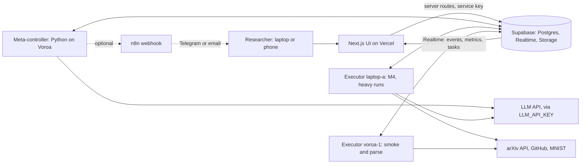
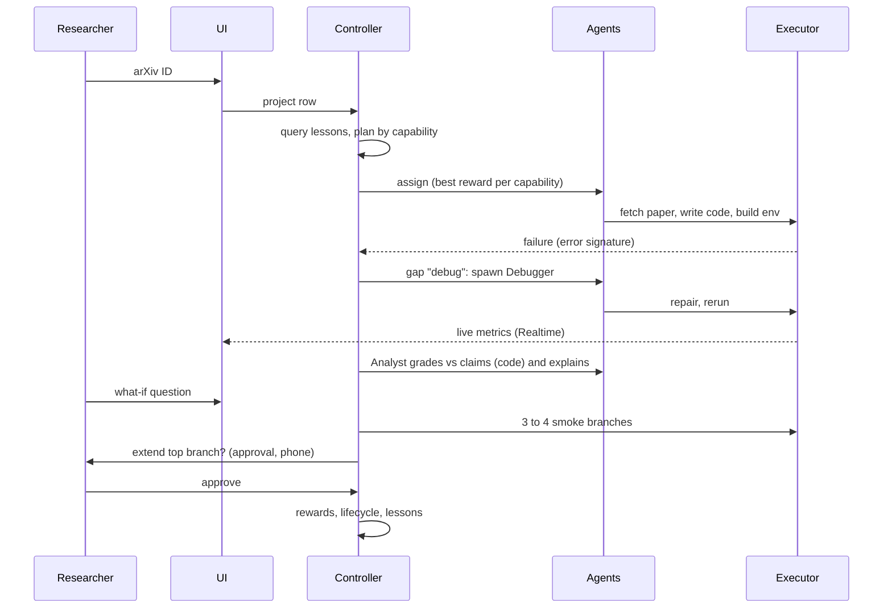
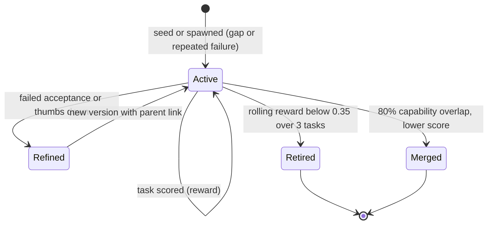
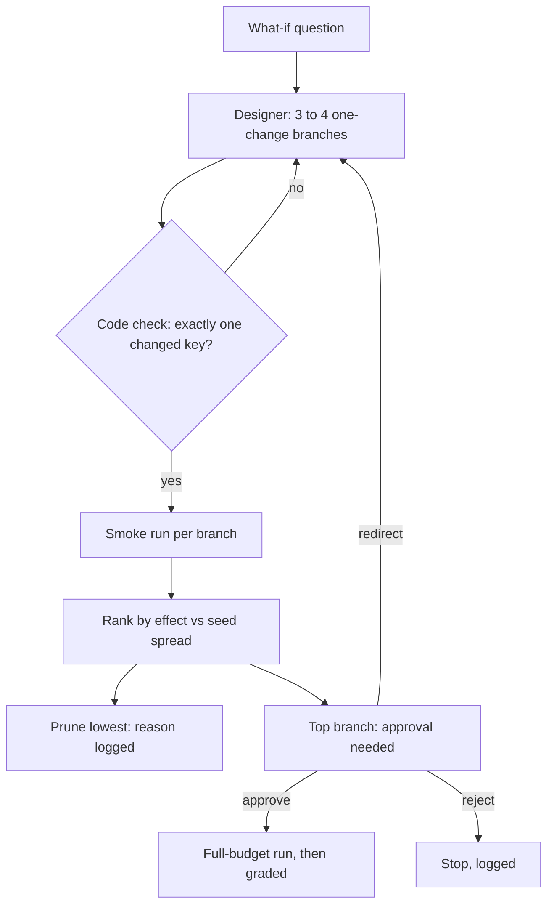
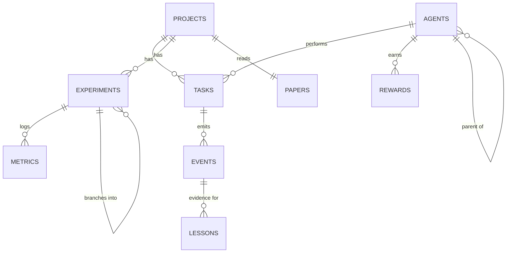
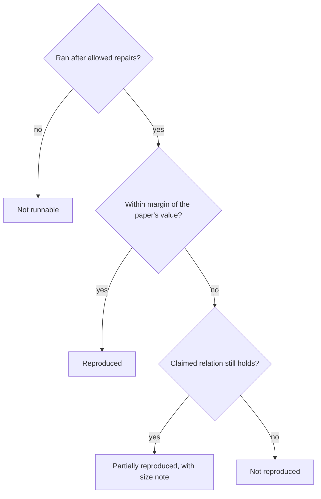

# PS3 Technical Spec: ClaimTrace Lab, an evolving AI research environment

This is the companion to `PS3-Blueprint.md`. It defines how the system works, precisely enough to build and to judge. In the repo it is saved as **`SPEC.md`**. Every coding session reads it before starting a task.

Status labels:
- **[planned]**: not built yet.
- **[built]**: code exists.
- **[measured]**: the number comes from a real run, with its log kept.
- **[estimate]**: a guess, labelled as one.

**Baseline:** our Round 0 prototype (`baseline/el01-auditor/`, Phases 0–5) is reused **as a baseline only**, with the organizers' permission. `lab/` wraps and upgrades it; §16 lists which module goes where.

**Two rules hold everywhere:**
1. **LLMs plan, read and write. Code computes** every number, verdict, reward and lifecycle decision.
2. **No simulated data.** Every metric comes from a real run. The only fallback is a **replay of real runs, labelled "Replay"**.

---

## 1. Features

| # | Feature | Produces | Spec | Status |
|---|---|---|---|---|
| F1 | Evolving agent team | Agent specs, plans, spawns, refinements, retirements and merges, each with a reason | §2–§5 | [planned] |
| F2 | Autonomous reproduction | Claims and settings from the paper, code, an environment, runs, a graded result | §7.1–§7.3 | [planned] |
| F3 | What-if fan-out | 3–4 one-change branches, smoke-tested, pruned or extended behind an approval gate | §7.4, §9 | [planned] |
| F4 | Why results differ | A settings diff (paper vs ours), branch effects and verdicts, with links to log lines | §7.5 | [planned] |
| F5 | Research memory | Lessons written after runs and applied before new plans, with the effect measured | §6 | [planned] |
| F6 | Control room and mobile | Team, Live, Experiments, Report and Notes views, plus an approvals queue | §10 | [planned] |

---

## 2. Agents are data

An agent is **one row** in `agents`. A single generic runtime (`lab/agents/runtime.py`) runs any spec. That is what makes spawning real: the controller writes a new row at runtime, and the runtime can execute it immediately.

### 2.1 Agent spec

| Field | Type | Meaning |
|---|---|---|
| `id`, `name` | text | e.g. `debugger-v1` |
| `role_prompt` | text | The system prompt (instructions plus any applied lessons) |
| `capabilities` | text[] | Tags from the registry (§2.3) |
| `tools` | text[] | A subset of the fixed tool set (§2.2) |
| `budget` | jsonb | `{max_tokens, max_cpu_s, max_steps}` |
| `version`, `parent_id` | int, uuid | Lineage for refinements |
| `status` | enum | `active` · `retired` · `merged` |
| `merged_into` | uuid | Set when the status is `merged` |
| `origin` | enum | `seed` · `spawned` · `refined` |
| `origin_reason` | text | Why it was created; shown in the UI |
| `created_by_task` | uuid | The task that triggered the spawn |

### 2.2 Fixed tool set (code; agents can only call these)

| Tool | What it does | Where it runs |
|---|---|---|
| `fetch_paper(arxiv_id)` | Gets the arXiv metadata and PDF, extracts the text with PyMuPDF, stores it in Storage | Controller or executor |
| `fetch_repo(url, commit?)` | Clones the repo and records the commit | Executor |
| `read_file`, `write_file`, `list_dir` | Act inside the run's working directory only | Executor |
| `make_env(requirements)` | Creates a `uv` venv with pinned requirements | Executor |
| `run(cmd, timeout_s)` | Runs a subprocess in the work directory with **no secrets in its environment** and a hard timeout; streams stdout | Executor |
| `query_memory(tags)` | Returns matching lessons | Anywhere |
| `emit(event, reason)` | Writes to `events` | Anywhere |

### 2.3 Capability registry

`read_paper`, `extract_claims`, `extract_settings`, `design_experiment`, `budget`, `write_code`, `setup_env`, `run`, `debug`, `compare`, `explain_diff`, `design_whatif`, `write_report`, `write_notes`.

### 2.4 Seed roster (at start-up)

| Agent | Capabilities | LLM? |
|---|---|---|
| Reader | read_paper, extract_claims, extract_settings | yes |
| Designer | design_experiment, budget, design_whatif | yes |
| Implementer | write_code | yes |
| EnvBuilder | setup_env | light (writes the requirements); `uv` does the work |
| Runner | run | **no** (code only) |
| Analyst | compare, explain_diff | code grades; the LLM writes the explanation text |
| Reporter | write_report, write_notes | yes |

**There is deliberately no Debugger at start-up.** The first failure creates a `debug` gap, and the controller spawns one (§4.3). This is real behaviour, not a script. If no failure happens, there is no spawn, and the demo says so honestly.

---

## 3. Meta-controller (`lab/controller/`)

A loop running on Voroa (or on Laptop A as a fallback). Each tick:

1. **Intake.** New `projects` rows and new what-if questions.
2. **Plan.** An LLM call gets the goal, the paper summary and the lessons that match the project's tags (§6). It returns an ordered list of steps, each with the **capability** it needs, inputs, acceptance check and budget. The plan is stored as `tasks` rows. The plan text and the lessons it used are emitted as an event with its reason.
3. **Assign.** For each ready task, pick the **active agent with that capability and the highest rolling reward**. If there is none, record a **gap** and spawn an agent (§4.3).
4. **Route.** The task's `required_caps` must match an executor with a recent heartbeat. Heavy runs go to `laptop-a`; smoke and parse tasks go to `voroa-1`.
5. **Gate.** Tasks with `requires_approval = true` wait in `awaiting_approval` until a decision row arrives (§9).
6. **Score.** When a task finishes, compute its reward (§5) and apply the lifecycle rules (§4).
7. **Learn.** When a run or experiment finishes, the Reporter proposes lessons and the controller stores them (§6).

Every decision writes an `events` row with `type`, `agent_id`, `task_id`, `message` and a **`reason`**. That is what the Live view shows.

---

## 4. Lifecycle rules (code, thresholds fixed in `lab/controller/rules.py`)

| Event | Trigger (computed by code) | Action |
|---|---|---|
| 4.1 **Refine** | An agent's task fails its acceptance check, or gets 👎 | The LLM writes version n+1 of `role_prompt` (adding the failure lesson). New row: `origin = refined`, `parent_id` = the old row. The old row is retired with the reason "superseded by vN+1" |
| 4.2 **Retire** | Rolling mean reward over the agent's last 3 scored tasks is **< 0.35** | `status = retired`, with the reason and the numbers shown |
| 4.3 **Spawn** | (a) No active agent has the required capability, **or** (b) the same task failed twice with the same agent | The LLM drafts a spec (name, role prompt, tools, budget) from the gap and the failure context. Code checks it (tools come only from the fixed set; budget within the project cap). Insert with `origin = spawned` and `origin_reason` |
| 4.4 **Merge** | Two active agents share **≥ 80%** of their capability tags, each with at least 3 scored tasks | The lower-scored one gets `status = merged` and `merged_into` the other. Its capabilities are unioned into the winner as a new version |

Each rule has a pytest case (core-logic tests).

---

## 5. Reward (code, `lab/controller/reward.py`)

```
reward = 0.6 · outcome + 0.2 · (1 − cost_norm) + 0.2 · feedback
outcome   ∈ {0, 0.5, 1}   failed / partial / passed (the task's acceptance check, run by code)
cost_norm = min(1, (tokens / 20,000 + cpu_seconds / 600) / 2)
feedback  ∈ {0, 0.5, 1}   👎 / none / 👍
```

- Stored per task in `rewards`. The rolling mean per agent is shown on the scoreboard, and clicking it shows the breakdown.
- The weights and budgets are constants in one file. **Changing them after 6 PM needs Laptop A's OK.**

---

## 6. Research memory (`lessons`)

- **Write.** After each finished experiment or failure-then-recovery, the Reporter proposes at most 3 lessons as structured fields: `{text, tags[], evidence_event_id, kind: failure_fix | setting_mattered | budget | agent_choice}`. Code keeps a lesson only if `evidence_event_id` exists.
- **Read.** Before planning and before each agent call, `query_memory(tags)` uses tag overlap: domain (`mnist`, `distillation`), error signature (e.g. `ModuleNotFoundError:torchvision`) and capability. Matched lessons are added to the prompt, and a `lesson_applied` event is emitted.
- **Proof (R14).** Run 2 of the same paper is compared with run 1 on: retries before the first successful run, wall-clock to the first result, and LLM tokens. The comparison is shown in the Report as "Memory effect" **[measured in the demo]**.
- **Seed (allowed by the organizers):** findings F1–F9 from the Round 0 MatchDG audit are imported as lessons, labelled "Imported from Round 0 audit", with evidence pointing to the Round 0 report sections. Example: "Check the model-selection rule (val loss vs val accuracy); it moved one result by about 26 points".

---

## 7. Experiments

### 7.1 Intake and claims
- `fetch_paper` gets the paper text. The Reader extracts:
  - **claims:** `{id, quote, page, table_or_section, metric, value, unit, direction, whose: method | baseline | oracle}`;
  - **settings:** `{key, value, quote, page}`. Keys: architecture, optimizer, lr, epochs, batch, regularisation, data subset, preprocessing, augmentation, temperature, seeds.
- Acceptance check (code) for Distillation: the claims include teacher, small-net and distilled test errors, and the values match the PDF quotes. The B0 numbers are the reference.

### 7.2 Build and run (execution ladder)
1. **Code.** If a repo exists, clone it at a pinned commit; otherwise the **Implementer** writes `train.py` from the claims and settings into the run's work directory.
2. **Environment.** EnvBuilder writes `requirements.txt` and runs `make_env`.
3. **Smoke run.** 1 epoch, a small subset, on `voroa-1` or `laptop-a`.
4. **Full run** within the budget planner's choice (§7.3), on `laptop-a`.

**On failure:** the error signature is extracted by code and the controller assigns a `debug` task. If no Debugger exists, one is spawned (§4.3).

**Repair policy (from Round 0):**
- Fixes that only make the code run are labelled `REPAIR(env)` or `REPAIR(code)`.
- Anything that changes data, model, loss, optimizer, metric or model selection is a **hypothesis branch**, never a repair.

**Logs:**
- Every stdout line is stored with its line number.
- Metric lines use one format: `METRIC name=value step=N`.
- The parser records `(experiment_id, step, name, value, log_line)`.

### 7.3 Budget planner (R19)
- The Designer proposes a scale (epochs, subset, seeds) under the project cap (default **20 CPU-minutes** for the reproduction).
- Code checks the proposal against the smoke run's time per epoch.
- The chosen scale and its reason ("3 seeds × 5 epochs ≈ 9 min on laptop-a, from smoke 1.8 min/epoch") are stored on the experiment and shown in the UI.

### 7.4 What-if fan-out (R12, R17)
1. The user asks a question (free text).
2. The Designer proposes **3–4 branches, each changing exactly one setting**. Code checks that each branch's config differs from its parent in one key only.
3. All branches get a **smoke run**.
4. Code ranks them by |effect vs parent| relative to the parent's seed spread. It **prunes** the lowest (reason: "effect inside noise") and marks the top one **extend**.
5. Extending needs approval (§9). Once approved, the branch runs at full budget.

Branches run in **git worktrees** or separate work directories, one per branch.

### 7.5 Grading and "why it differs" (R11, R22)

**Margin.** Declared before the run and stored on the experiment: `margin = max(paper's stated spread, floor)`. Floor for MNIST test errors: **10 errors out of 10,000** [estimate; fixed before the first graded run].

**Verdicts (code):**

| Claim type | Verdict |
|---|---|
| Absolute | *Reproduced* if \|ours − paper\| ≤ margin. Otherwise *Partially reproduced* if the claimed relation still holds (e.g. distilled < hard-label). Otherwise *Not reproduced* |
| Relative | Same, applied to the gap |
| Couldn't run after allowed repairs | *Not runnable* |

With fewer than 3 seeds, the verdict carries "(1 seed)".

**Why it differs:**
- A **settings diff** table (paper value vs our value, with a quote and our config key). Each row is labelled: *scale reduction (budget)*, *paper omission*, *difference* or *same*.
- **Branch effects** for any row that was tested.
- The **Analyst LLM** writes a plain-language explanation using **only** these tables. It cannot introduce new numbers; code checks that every number in its text appears in the tables.

---

## 8. Executors and queue

- `executors` rows hold a heartbeat every 10 s, plus `name`, `caps` and `busy`.
- Workers call the RPC `claim_task(executor_name, caps)`. It selects one `queued` task whose `required_caps ⊆ caps`, `FOR UPDATE SKIP LOCKED`, and sets it to `running`.
- Workers use the **service key** and an **outbound connection only**.
- Planned workers:
  - `laptop-a`: caps `train,heavy,smoke,parse`;
  - `voroa-1`: caps `smoke,parse`;
  - `laptop-b`: spare;
  - Kaggle: STRETCH.

---

## 9. Human in the loop and mobile (R16, R18)

- A task with `requires_approval` shows in the `/approvals` queue (mobile-first), with the agent's proposal, the reason and the cost estimate.
- The decision is `approve`, `reject` or `redirect`. A redirect includes a note, and the controller replans with it.
- 👍/👎 is available on every finished task, and feeds `feedback` in the reward.
- **Optional:** when a task enters `awaiting_approval`, the controller POSTs to `N8N_WEBHOOK_URL`. The n8n workflow sends a Telegram message or email with the approval link.

---

## 10. UI (Next.js `web/`)

| Route | View | Shows |
|---|---|---|
| `/` | Projects | List of projects; "New research" (arXiv ID, optional repo URL, budget) |
| `/p/[id]?tab=team` | **Team** | React Flow lineage graph (seed, spawned, refined, retired, merged edges); agent cards with capabilities, version, rolling reward and status |
| `/p/[id]?tab=live` | **Live** | Realtime event stream with filters by agent, type and task. Every row shows *what* and *why* |
| `/p/[id]?tab=experiments` | **Experiments** | Tree of reproduction → branches; status, executor, budget reason; Recharts metric curves; pruned or extended with the reason |
| `/p/[id]?tab=report` | **Report** | Claims vs ours, verdicts, settings diff, branch effects, explanation, memory effect. Every number links to `/logs/[exp]#L<line>`. "Export Markdown" button |
| `/p/[id]?tab=notes` | **Notes** | Research notes written by the Reporter (Markdown), editable |
| `/approvals` | **Approvals** | Mobile-first queue: approve, reject, redirect |
| `/agents` | **Scoreboard** | All agents across projects, rewards, lifecycle history, lessons |
| `/logs/[exp]` | Log viewer | Line-numbered log; highlights `#L<n>` |

**Header (every page):** executor status dots, plus the "latest event" and "latest metric" timestamps (the live-data check).

**Design:** works at 375 px wide; dark and light themes; no chat box as the main interaction.

---

## 11. Data model (Supabase; key fields only)

| Table | Key fields |
|---|---|
| `projects` | id, title, arxiv_id, repo_url, budget_cpu_min, status, tags[], created_at |
| `papers` | id, project_id, arxiv_id, title, pdf_path, text_path, claims jsonb, settings jsonb |
| `agents` | see §2.1 |
| `tasks` | id, project_id, parent_task_id, capability, required_caps[], agent_id, executor, status (`queued`, `running`, `awaiting_approval`, `done`, `failed`, `rejected`), requires_approval, decision, decision_note, input jsonb, output jsonb, acceptance jsonb, tokens, cpu_seconds, started_at, finished_at |
| `experiments` | id, project_id, parent_id, label, config jsonb, changed_key, budget_reason, margin, status, executor, verdicts jsonb, pruned_reason, log_path |
| `metrics` | id, experiment_id, step, name, value, log_line, ts |
| `events` | id, project_id, agent_id, task_id, type, message, reason, data jsonb, ts |
| `rewards` | id, agent_id, task_id, outcome, cost_norm, feedback, reward, ts |
| `lessons` | id, project_id, kind, text, tags[], evidence_event_id, times_applied, created_at |
| `executors` | name, caps[], busy, last_heartbeat |
| `llm_calls` | id, agent_id, task_id, model, tokens_in, tokens_out, mode (`live` / `replay`), cache_key, ts |

**Row-level security:**
- The `anon` role gets `SELECT` only.
- All writes go through server routes or workers using the service key.
- Realtime is enabled on `events`, `metrics`, `tasks`, `agents` and `experiments`.

---

## 12. API (Next.js route handlers; every write needs the `DEMO_PASSCODE` cookie)

| Method | Path | Purpose |
|---|---|---|
| POST | `/api/projects` | Create a project from `{arxiv_id, repo_url?, budget_cpu_min?}` and queue a `plan` task |
| POST | `/api/projects/[id]/whatif` | `{question}` queues a `design_whatif` task |
| POST | `/api/tasks/[id]/decision` | `{decision: approve, reject or redirect, note?}` |
| POST | `/api/tasks/[id]/feedback` | `{value: up or down}` |
| GET | `/api/projects/[id]/report.md` | Markdown export of the Report |
| POST | `/api/login` | Checks `DEMO_PASSCODE` and sets the cookie |
| GET | `/api/health` | Liveness for scans and demos |

The Python side exposes **no HTTP API**. The controller and workers talk only to Supabase.

---

## 13. Security

- No secrets in the repo; `.env.example` lists names only.
- The service key lives only on the server, Voroa and the executors.
- LLM-written code runs **only on executors**, in a per-run work directory, with a timeout and a stripped environment (no keys). Network access is allowed only for the dataset or package download step.
- Write routes are gated by `DEMO_PASSCODE`; row-level security makes `anon` read-only.
- ShipReady scans the deployed URL at 5:30 AM. Fix critical and high findings only.

---

## 14. Honesty rules (carried from Round 0)

1. No LLM computes or judges a number.
2. Every number traces to an `(experiment, log line)`.
3. Say what was done by hand. Label estimates next to the measured numbers.
4. Never claim an unbuilt feature. Stretch items are labelled "next".
5. Replay is always labelled "Replay"; live is the default.
6. No participant names in judge-visible material, unless the organizers say otherwise.

---

## 15. Diagrams (Mermaid)

### 15.1 System architecture


### 15.2 Research workflow


### 15.3 Agent lifecycle


### 15.4 What-if fan-out


### 15.5 Data model


### 15.6 Verdict logic


---

## 16. Round 0 baseline map (`baseline/el01-auditor/` → `lab/`)

| Round 0 piece | Round 1 location | Rule |
|---|---|---|
| `el01` environment builder | `lab/agents/tools.py: make_env` | Wrap and generalise; `uv`; no pinned robustdg versions as defaults |
| `el01` runner and parsers | `lab/executor/worker.py`, `logparse.py` | Reuse the parsing logic; output goes to Supabase; Windows-safe process start |
| `el01` repair agent | Debugger agent tools | Keep the REPAIR(env/compat) vs HYPOTHESIS split and the inertness check |
| `el01` claim cards and linker | Reader (`extract_claims`) | Same claim schema, extended with `whose` and `direction` |
| `el01` settings diff (schema v2) | Analyst (`explain_diff`) | Same 25 keys plus `temperature` |
| `el01` grader and verdicts | Analyst grading | Code computes; the margin is declared before the run |
| `el01` LLM backend (replay cache, usage log) | `lab/llm.py` | **Remove `claude -p`**; providers via `LLM_API_KEY`; calls logged to `llm_calls` |
| MatchDG golden files and report | `lessons` seed + `lab/tests/test_baseline_regression.py` + a precomputed project "MatchDG (Round 0)" | Labelled precomputed; never shown as a live run |

`baseline/` is **read-only** reference code. Fixes go into `lab/`, never into `baseline/`.
