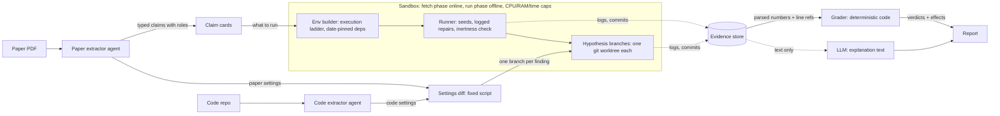
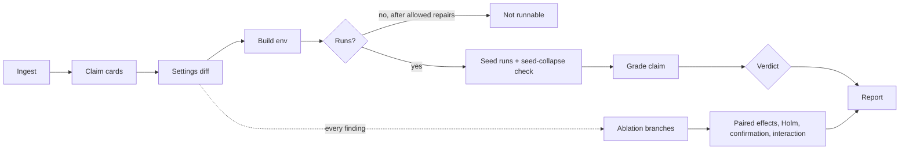
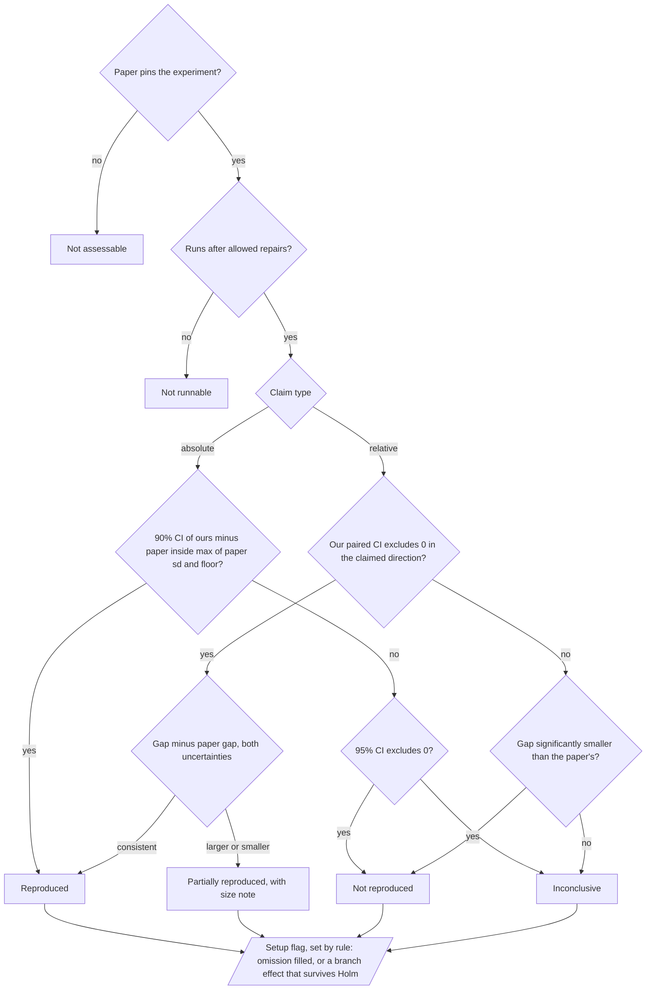

# EL-01 Technical Spec: Claim-Level Reproducibility Auditor

Companion to the concept note (`EL-01-deep-analysis.md`) and the blueprint. This file defines how the system works precisely enough to build and to judge. Everything marked **[measured]** comes from our audit of MatchDG (ICML 2021); every number in those parts is rendered by a script from the run logs, and the logs, commits and scripts are in the evidence repository (https://claude.ai/artifact/2ah3Kw65GddPpPUt7mZLGa#evidence).

---

## 1. What we build: four features

| # | Feature | What it produces | Status |
|---|---|---|---|
| 1 | **Claim cards** | Every reported number becomes a typed, pinned claim (absolute, relative or trend) with page, table cell, quoted text, and whose number it is (the paper's method, a baseline, or an oracle) | Hand-built for the audit. **Blind LLM extraction tested on MatchDG** (§2): 9/9 target cells right in both runs. The `entrypoint` (claim to runnable command) was filled by hand. Not yet wired into the pipeline |
| 2 | **Paper vs code settings diff** | One table of settings with three kinds of finding: *difference*, *code omission* (paper states it, code lacks it), *paper omission* (code does it, paper never says) | Hand-built for the audit (3 findings). **Blind LLM extraction plus a fixed diff script tested on MatchDG** (§3): our 3 hand findings recovered in all 4 run pairings, plus 3 we had missed. Not yet wired into the pipeline |
| 3 | **Controlled runs with honest statistics** | Date-pinned environment, logged repairs with an inertness check, multi-seed runs, verdicts computed by code from parsed logs | **Runner and grader working [measured]; repairs by hand** (inertness check scripted) |
| 4 | **Diff-guided ablation** | Each diff finding becomes a git branch; its effect on each claim is reported with a paired 95% CI, a multiplicity correction and a confirmation run | **Runner and grader working [measured]; branch patches by hand** |

Everything else (UI, report export, author checklist) is presentation on top of these four. The three steps still done by hand (repairs, branch patches, claim-to-command links) are the build's first work, each with a test (§9).

## 2. Claim cards

### Schema
```json
{
  "claim_id": "C2",
  "type": "relative",                     // absolute | relative | trend
  "role": {"PerfMatch": "oracle", "ERM": "baseline"},   // whose number: method | baseline | oracle
  "statement": "Matching on the true stable feature (oracle) improves target accuracy over ERM",
  "quote": "The results improve substantially: out-of-domain accuracy is now 78%.",
  "source": {"page": 4, "section": "3.2", "table": "Table 1", "cells": ["PerfMatch/Target", "ERM/Target"]},
  "metric": {"name": "accuracy", "split": "target test", "unit": "%"},
  "reported": {"method": 77.8, "baseline": 57.6, "delta": 20.2, "spread": "sd over 10 seeds", "aggregation": "mean"},
  "config_ref": ["App. A.1", "Table 7"],
  "entrypoint": "train.py --dataset slab ... --method_name erm_match --match_case 1.0 --penalty_ws 1.0"
}
```

### Rules
- **Typed claims.** A relative claim ("A beats B by g") is only tested by running A *and* B under the same harness, seeds and data.
- **Role is recorded.** Every number is tagged as the paper's method, a baseline, or an oracle (a method that uses information not available in practice). Report headlines name the role. Our first draft called PerfMatch "the paper's method"; it is an oracle, and the claim card now says so.
- **Misattribution guard.** A number must match the quoted text *and* its table coordinates (row, column, dataset, split). A right number from the wrong row fails. Figure-only claims are marked `figure-only` and skipped unless a digitised value is supplied.
- **Aggregation is recorded** (mean over seeds, best of n, single run), and we compare like with like.

### Extraction test [measured]
Two independent LLM agents read the MatchDG paper through a web fetcher, with no access to our tables, and filled the claim schema for Table 1 (prompts and outputs in `extraction/`). Both runs got all 9 target-domain cells right and agreed on all 27 cells of the table. They also caught a typo in our hand-built table: we had typed C-CORAL's sd as 6.01; the paper says 4.69. One test on one paper shows the step works on MatchDG, not that it generalises.

## 3. Paper vs code settings diff

Each setting is extracted into one schema (`extraction/schema.md`, 20 keys) from both sides by separate agents, then compared by a fixed script (`scripts/extraction_diff.py`) with three rules: the paper evaluates on a domain the code cannot produce (code omission); the paper is silent and the code sets a non-default value (paper omission); both state a value and they differ (difference).

**Schema version 2 (for the prototype).** The 20-key schema used in the blind test has no slot for preprocessing, and F7 (below) is a data-pipeline difference it could not express. Version 2 adds five keys: `data.preprocessing.resize`, `data.preprocessing.normalization`, `data.augmentation` (what, and which split and use it applies to: training, validation, model selection), `data.domain_transform` (how each domain is made, including the sign of a rotation), and `train.model_selection_data` (which split, and which version of it, the selection metric reads). The blind test is re-run with version 2 as part of the build plan (§9).

**No severity labels.** Our own audit showed why: the finding a reader would rank highest (the missing target domain) moved the oracle result by +2.1 points, while two "medium" ones (F2, F3) each moved it by more than 25. Every finding gets a branch. When the branch budget runs out, branches are ordered by run cost only, and the report lists the ones not run.

**[measured] MatchDG slab (Table 1), paper vs repo at commit 3eee173:**

| # | Setting | Paper | Code | Kind | Found by |
|---|---|---|---|---|---|
| F1 | Target domain | p = 1.0 (Sec 3.2, App. A.1) | never generated (`data_gen_syn.py:42`) | code omission | hand, blind extraction, SciCoQA |
| F2 | Model selection | "early stopping based on the validation loss" | epoch with best validation *accuracy* (`train.py:306`, `erm_match.py:155`) | difference | hand, blind extraction |
| F3 | Optimizer | "SGD" | SGD + momentum 0.9 + Nesterov (`algo.py:185`) | paper omission | hand, blind extraction |
| F4 | Matching weight over training | λ (Table 7), no schedule | ramps linearly from ≈0 to λ (`erm_match.py:109`) | paper omission | blind extraction, epoch trace |
| F5 | DANN/CDANN learning rate | 0.1 for all methods | hard-coded 0.01 (`dann.py:38`) | difference | blind extraction only |
| F6 | Hyperparameter tuning | on 250 extra source-domain points | `slab-tune.py:82-100` ranks settings by a log line that holds *target* test accuracy | difference | blind extraction (1 of 2 code runs) |

**Extraction result [measured].** All four paper × code run pairings recover our three hand findings (F1 to F3) and two we had missed (F4, F5). F6 came from one of the two code runs. Before a bug fix in the diff script (a name filter that also matched "cross-domain"), F4 was missed in every pairing; the fix is in the script history and the report. SciCoQA lists two discrepancies for this repo: F1 ([row 68](https://github.com/UKPLab/scicoqa/blob/463162906459be508ed4a2294fcaede9fa072036/data/scicoqa-real-v1.1.jsonl#L68)) and F7 below ([row 67](https://github.com/UKPLab/scicoqa/blob/463162906459be508ed4a2294fcaede9fa072036/data/scicoqa-real-v1.1.jsonl#L67)). Neither our hand audit nor the blind extraction found F7, so our SciCoQA recall on this repo is 1 of 2. F2 to F6 are not in SciCoQA.

**[measured] MatchDG itself (Suppl. Table 11, Rotated MNIST, LeNet):** the paper's Tables 8 and 9 (lr 0.01, batch 16, weight decay 5e-4, 100 epochs, match penalty 1.0; contrastive phase 50 epochs, batch 512, τ 0.05) match the repo's `reproduce_rmnist_lenet.py` and defaults. F3 (momentum) and F4 (ramped weight) apply here too. The paper does not say how many seeds Table 11 averages; the code's default is 3. One data difference reaches this table:

| # | Setting | Paper | Code | Kind | Found by |
|---|---|---|---|---|---|
| F7 | Rotated MNIST augmented copy | no augmentation described for Rotated MNIST (the supplement describes it for PACS and Chest X-ray) | random crop, then horizontal flip *after* rotation, so a flipped +θ digit is a mirrored digit at −θ (`data_gen_mnist.py:34-35, 85`) | paper omission | SciCoQA only |

**F7 is on the path for MatchDG only [measured].** ERM, RandMatch, the oracle and MatchDG's second phase read the plain copy (`--mnist_aug 0`). MatchDG's contrastive phase validates on pairs of plain and augmented images (`reproduce_rmnist_lenet.py:25` → `train.py:217-218` → `utils/helper.py:173-175` → `data/mnist_loader_match_eval.py:38`) and keeps the epoch with the best match score (`algorithms/match_dg.py:263-266`); the second phase matches with that checkpoint. Branch h7 removes only the flips (10,752 of 21,600 augmented images change, nothing else). With the rule hashed first, MatchDG's six-domain average moved by −0.04 points (95% CI −0.41 to 0.34) and 0 of 6 cells survive Holm, although the chosen checkpoint changed in 8 of 18 runs. So F7 is a note on MatchDG's Table 11 claims, not a "setup differs" reason (report Part A3).

### Known limit
SciCoQA (arXiv 2601.12910) reports that the best LLMs recover 46.7% of real paper-code discrepancies, worst on paper omissions. So the diff is a hypothesis generator, never a guarantee; our own hand audit and blind extraction missed one of SciCoQA's two rows for robustdg (F7, a data-pipeline omission), which is why schema version 2 adds data-pipeline keys and §9 makes row 67 the code extractor's first data-pipeline test. Two mitigations: **omission ablations** (components the code has and the paper never mentions are switched off, since the paper offers no value to swap in), and **"unexplained" as a valid answer** (if no branch closes a gap, the report says so and lists what was tested).

## 4. Controlled runs

### Execution ladder
Cheapest route first: (1) results the repo ships, (2) the repo's Dockerfile, (3) a build with every package pinned to the repo's last-commit date (`uv pip install` with `UV_EXCLUDE_NEWER=<date>`).

**[measured]** Commit date 2022-03-20 → Python 3.9, torch 1.11.0. Two imported packages are missing from `requirements.txt` (`more_itertools`, `opacus`); the date pin picks opacus 1.1.0, whose API the code does not use.

### Repair policy
The runner may patch code only to make it *run*, never to change *what is measured*.

| Class | Allowed? | Examples | Handling |
|---|---|---|---|
| Environment | yes, logged | absolute paths, GPU-only device selection, missing imports | own commit `REPAIR(env)` |
| Compatibility | yes, logged, **inertness checked** | deprecated API calls on code paths the experiment does not use | own commit `REPAIR(compat)` plus the check below |
| Anything touching data, model, loss, optimizer, metric, selection | **no** | adding a missing domain, changing a split | a **hypothesis branch**, never a silent repair |

**Inertness check (a test, not a claim).** If the code runs without the patch, run the smoke test with and without it and require identical metrics. If it crashes without the patch (the usual case), trace a run with the patch and require zero calls into the patched code path or library during training. A repair that fails the check is reclassified as a hypothesis branch.

**[measured]** Three repairs on MatchDG: data path (`utils/slab_data.py:75`), CPU fallback (`train.py:169`, `test.py:183`), and an unconditional differential-privacy hook call (`algo.py:276`) guarded by the same `dp_noise` flag as its twin at line 243. The shipped code crashes without the third, so it was traced: **0 calls into opacus** during a 5-epoch training run with the repair (`logs/inertness_opacus_trace.log`, `scripts/trace_opacus.py`).

### Data handling
Two phases. **Fetch** runs with network on, against an allowlist of dataset hosts, records checksums and caches. **Run** has network off. Generated datasets (slab, rotated MNIST) are built by the repo's own scripts.

### Seeds
- Default seed count is max(5, the paper's count); the paper's count when stated, else the code's default (MatchDG Table 1: 10; Table 11: not stated, code default 3).
- **Seed-collapse check.** Identical numbers across seeds mean a hard-coded seed; we scan for constant-seed calls and check run variance. **[measured]** MatchDG passes.

### Deterministic grading
Metrics are parsed from logs by code (`parse_runs.py`, `parse_epochs.py`), each value stored with its log file and line number, including the epoch the code's rule selected and the source-domain accuracy at that epoch. The verdict is a pure function of those numbers. LLMs extract claims and settings and write explanation text; they never compute or judge a number. An untraceable number is a pipeline bug that blocks the report.

## 5. Statistics and verdicts

The paper reports mean ± sd over n_p seeds; we have mean ± sd over n_o seeds (population sds are converted to sample sds before any interval).

- **Absolute claim: an equivalence test.** Margin δ = max(the paper's own sd for that number, a practical floor), declared before the runs. The floor is a user setting, default 1 accuracy point: the smallest difference a reader would care about. *Reproduced* only if the whole 90% Welch CI of (ours − paper) lies inside ±δ (two one-sided tests at α = 0.05). *Not reproduced* if the 95% CI excludes 0 and equivalence fails. Everything else is *Inconclusive*. Because the paper's sd widens both the margin and the CI, a noisier paper is not easier to pass. Every report also prints the **tightest margin the data supports**, so a reader can apply their own.
- **Relative claim: direction and size, both uncertainties.** Direction: our paired-by-seed 95% CI for A − B must exclude 0. Size: the 95% CI of (our gap − paper's gap), where the paper's gap has standard error √(s_A²/n + s_B²/n) from its reported sds, combined with ours (Welch–Satterthwaite df).

| Verdict | Absolute rule | Relative rule |
|---|---|---|
| Reproduced | 90% CI of Δ inside ±δ | direction holds and the gap difference CI contains 0 |
| Partially reproduced | n/a | direction holds, the gap difference CI excludes 0; size note "gap larger than reported" or "gap smaller than reported" |
| Not reproduced | 95% CI excludes 0 and not equivalent | direction not shown, gap significantly smaller |
| Inconclusive | anything else after the seed budget | anything else |
| Not runnable | no number after the execution ladder and allowed repairs | same |
| Not assessable | the paper omits details needed to pin the experiment | same |

One function (`label()` in `scripts/verdicts.py`) writes every verdict string, and every page is rendered from it, so a verdict reads the same in the concept note, this spec, the report and the blueprint.

**"Setup differs" is a flag, set by a rule in code** (`setup_flag()`): a claim gets it when (a) a code omission had to be filled to run it, or (b) a finding's branch has a Holm-surviving effect on a method the claim names. Findings that apply but were not tested, or were tested with no Holm-surviving effect, become notes under the claim. **[measured]** Every Table 1 claim gets it from (a), the missing target domain F1; PerfMatch, ERM and RandMatch also from (b), F2 or F3. F4 is a reason nowhere: its branch had no detectable effect. The Table 11 claims needed no filled omission, and the one branch run on them (F7, MatchDG only) had no Holm-surviving effect, so they carry no flag; their notes say F7 was tested and F3 and F4 apply but were not tested there.

**Why the floor.** **[measured]** On MatchDG's Table 11 the paper's sds go down to 0.1 points, one test image in 1,000. With the margin equal to the paper's sd, our first 3-run pass graded all 28 Table 11 numbers Inconclusive although every cell was within 0.9 points. A tool whose main output on a well-behaved paper is "Inconclusive" looks like a tool that cannot decide. We added the floor after that pass, so we re-ran Table 11 on fresh data with the floor declared first (report, Part A; `logs/matchdg_lenet_confirm/PREREGISTERED.txt`). That run graded 13 of 28 numbers Reproduced, 15 Inconclusive and 0 Not reproduced.

## 6. Diff-guided ablation (feature 4)

A one-factor-at-a-time ablation whose factors come from the settings diff, in the spirit of delta debugging (Zeller) and `git bisect`. We do not call it proof.

1. **Branch.** Each finding becomes a git branch off the repaired baseline, changing one thing (paper's value swapped in, or an omitted component switched off). Branches run in parallel git worktrees. An ambiguous setting gets one branch per reading. **Self-check:** the code extractor is re-run on each branch, and the diff against the baseline must show exactly one changed setting, the one the finding names; a patch that changes two things is rejected before it runs.
2. **Measure.** Same seeds as the baseline. Effect = branch − baseline, **paired by seed**, 95% CI and paired t-test. The report also shows the epoch each selection rule picked and the source-domain accuracy there, so "the model never trained" can be told apart from "the model learned something else".
3. **Multiplicity.** Holm correction across all exploratory effects in a report. An effect is named only if it survives; others read "CI excludes 0, not after correction" or "no detectable effect".
4. **Confirm.** The largest effect is re-run on fresh seeds as a separate pre-specified test.
5. **Interaction.** The top two branches are combined. If the combined effect differs from the sum, the report says the causes interact and never shows a "share of the gap".

**[measured] MatchDG slab, effect on target accuracy, paired over seeds 0–9 (✓ = survives Holm across all 20 exploratory effects):**

| Branch | ERM | RandMatch | PerfMatch (oracle) | PerfMatch: epoch picked (median), source val. acc. |
|---|---|---|---|---|
| h1: select by validation cross-entropy (one reading of the paper) | +4.8 (2.9 to 6.6) ✓ | −3.8 (−6.8 to −0.7) | −25.8 (−34.4 to −17.2) ✓ | 1, 98.2% |
| h1b: select by full validation objective (the other reading) | same as h1 (ERM has no matching term) | +5.5 (2.8 to 8.2) ✓ | +4.7 (−2.5 to 11.9) | 88, 99.0% |
| h2: plain SGD, as the paper states | −3.8 (−6.4 to −1.1) | −4.1 (−6.9 to −1.3) | −28.7 (−34.7 to −22.8) ✓ | 27.5, 98.6% |
| h2 diagnostic: plain SGD for 1000 epochs | −0.5 (−1.8 to 0.7) | +5.0 (−0.8 to 10.7) | +0.3 (−5.2 to 5.8) | 531.5, 99.5% |
| h1 + h2 together | −2.5 (−5.9 to 0.9) | not run | −29.2 (−35.0 to −23.3) ✓ | 4, 98.3% |
| h3: evaluate on p = 0.9, the domain the code generates | +4.9 (3.1 to 6.7) ✓ | +4.8 (2.8 to 6.7) ✓ | +2.1 (0.6 to 3.6) | 73.5, 99.5% |
| h4: constant matching weight (code ramps it from 0) | not run | +3.2 (−1.3 to 7.6) | −2.4 (−10.5 to 5.7) | 55.5, 99.4% |
| h1 confirmation, fresh seeds 10–19 | +4.3 (2.9 to 5.7) | not run | −25.4 (−30.8 to −20.1) | 1 |

Under h1, the cross-entropy rule stops PerfMatch at epoch 1 with 98% source accuracy: it trained, but stopped before the matching weight (which ramps up from about 0, F4) had any effect. Under h2, every method reaches about 98.5% source accuracy, so it is not a failure to train; plain SGD at the paper's 100 epochs does not learn the stable slab feature, and with 1000 epochs it does. The momentum is a training-budget detail, not a different result.

## 7. Self-evaluation

| What | Ground truth | Metric | Status |
|---|---|---|---|
| Claim extraction | hand-labelled tables | exact match on value and coordinates | MatchDG Table 1: 9/9 cells, 2 of 2 runs [measured]; 10 papers planned |
| Settings diff | SciCoQA's 92 real discrepancies from 72 papers | recall and precision per kind | MatchDG: 3/3 hand findings in 4 of 4 pairings, plus 3 new [measured]; on robustdg we found 1 of SciCoQA's 2 rows [measured]; the full SciCoQA set is planned |
| Verdicts | ML Reproducibility Challenge reports | agreement with the human reproducer per claim | MatchDG compared (concept note §2) |
| Determinism | each paper run twice | identical verdicts | grading is pure code; extraction runs agreed on all 27 cells |
| Regression | MatchDG golden outputs (`golden/`): hand-built tables, findings F1–F6, every verdict, number and flag | every pipeline change reproduces them exactly | 73 verdicts and 53 other graded numbers re-derived from the raw logs, plus 6 extraction checks: 0 mismatches (2026-10-03) [measured] |
| Generality | a second paper, run blind end to end | findings against its SciCoQA row or MLRC report | first milestone (§9) |

## 8. Cost, runtime and scaling

**[measured] on 4 vCPU, 16 GB RAM, no GPU, one thread per job, four jobs in parallel:**

| Step | Time |
|---|---|
| Environment build, date-pinned | about 2 minutes |
| Slab data generation | 7 s |
| One slab method × 10 seeds × 100 epochs (small MLP on 2-D data) | 43–49 s (ERM, matching), 47–57 s (CORAL, DANN variants), 79–84 s (MMD variants) |
| Same, 1000 epochs | 383–415 s |
| Rotated MNIST data generation (LeNet setting) | 17 s |
| One Rotated MNIST method × 3 seeds × 100 epochs, one test domain (LeNet) | 202–220 s for ERM, RandMatch or PerfMatch; 547–571 s for MatchDG (both phases) |
| Whole audit | 542 training runs, 383 minutes of single-thread compute |

An earlier MMD timing of 593 s is withdrawn: its log was deleted by mistake; the re-run, with its log kept, took 79 s.

These are small models. The slab model is a tiny MLP and LeNet is a small CNN, so these times say little about heavier papers in the organisers' set. That is why the seed and branch budget is computed from a smoke run on each paper, never assumed.

**Scaling.** Compute grows with claims × seeds × (1 + branches): every claim needs its seeds, and every finding adds a branch that re-runs the methods it touches. Per run set, measured:

| Run set | Training runs | Single-thread compute | Wall-clock |
|---|---|---|---|
| Table 1 (slab): baseline, all branches, fresh-seed confirmation | 380 | 49 min | not separable (run sets overlapped) |
| Table 11, first run | 72 | 118 min | 32.5 min (24 jobs, 4 at a time) |
| Table 11, confirmation | 72 | 129 min | 35.2 min (24 jobs, 4 at a time) |
| F7 branch, MatchDG only | 18 | 87 min | 14.6 min (6 jobs, 6 at a time) |
| **Whole audit** | 542 | 383 min | |

A full 72-run Table 11 pass took 32.5 and 35.2 minutes of wall-clock with 4 jobs at a time, so the whole audit is about 96 minutes at that rate [inferred: single-thread minutes ÷ 4]. Wall-clock comes from the run scripts' start and end files (`scripts/wallclock.py`); only run sets that had the machine to themselves are reported.

| Lever | Status |
|---|---|
| **Selection-rule branches need no retraining.** A branch that only changes which checkpoint is reported trains exactly like the baseline, so logging every candidate selection metric once turns it into a lookup. | **[measured]** The per-epoch traces of h1 and h1b are identical to the baseline's (24,000 lines in 8 logs, `scripts/check_selection_traces.py`). 80 of the 380 slab runs were such branches. |
| **Cache environments by commit date, datasets by checksum** | Environments: done. Datasets: planned; the F7 check found the generated training and test files byte-identical across branches. |
| **Run branches in parallel** across worktrees and machines; each job is one (method, test domain) pair | One machine, 4 jobs at a time: done. Several machines: planned. |
| **Set the budget from a smoke run**: one seed and a few epochs, then seeds × branches sized to the cap; branches not run are listed | Planned |
| **Measure tokens per paper** | Not measured yet. An earlier estimate (30–60k input tokens for extraction) is withdrawn until the second-paper run measures it. |
| **CPU papers only** | The problem statement limits the task to small CPU papers; GPU papers are out of scope. |

## 9. Build plan

The extraction steps have had a blind test. The three agentic steps that make this an automated auditor have not, and that is where the build will break, so they are built and tested first.

| Order | Step | Test that says it works |
|---|---|---|
| 1 | **Repair agent**: classify each patch (environment, compatibility, hypothesis), then run the inertness check (§4) | On MatchDG it reproduces our three repair commits and sends the missing target domain to a hypothesis branch |
| 2 | **Claim-to-command linker**: turn a claim card ("Table 1, PerfMatch") into a runnable command | On MatchDG it produces the commands we wrote by hand for all 9 Table 1 rows and all 24 Table 11 cells |
| 3 | **Branch-patch writer**: one commit per finding | Self-check on every branch (§6): re-run the code extractor, require exactly one changed setting |
| 3b | **Code extractor on a data-pipeline question** (schema version 2) | On robustdg it must trace SciCoQA row 67 to the code path we traced by hand for F7: the flipped copies reach only MatchDG's contrastive-phase checkpoint selection |
| 4 | **First milestone: a second paper, end to end, blind** | Two CPU-runnable papers with a SciCoQA row or an MLRC report, run before any UI; the known discrepancy is read only after the run and scored like §3. The run also measures wall-clock time and tokens per paper for §8 |
| 5 | **Regression** | `scripts/regression.py` re-derives every MatchDG output from the raw logs and extractor outputs; 0 mismatches against `golden/` before any change ships |
| 6 | Report UI and demo | Precomputed MatchDG and second-paper reports, plus one live run |

The grader rules were fixed before any UI: one verdict list, the "setup differs" rule and the practical floor all live in `scripts/verdicts.py` (rules version 2; version 1 is kept in `scripts/v1/`).

**Second-paper candidates** (picked from SciCoQA rows; the team stays blind to the discrepancy text until after the run):

- **PGExplainer: Parameterized Explainer for Graph Neural Network** (NeurIPS 2020; flyingdoog/PGExplainer @ ec57ea2). Six SciCoQA rows from an MLRC 2020 report, all on the code path behind the audited table; GNN explanation, so a different kind of paper from MatchDG. Audit target: Table 2, PGExplainer explanation AUC, 6 cells, mean ± sd over 10 stated runs. Runtime: about 1 to 2.5 h for 10 seeds (estimated from the notebooks' saved timings, not run). Main risk: setup: TensorFlow 2.0 on Python 3.7, notebooks only, no seed loop, some wrong paths; its README links the reproduction report, which the blind run must not see.
- **Label-Free Explainability for Unsupervised Models** (ICML 2022; JonathanCrabbe/Label-Free-XAI @ 3f6fd5e). Not a graph paper: small PyTorch autoencoders on MNIST, so the pair covers two frameworks (TensorFlow, PyTorch) and two kinds of model. One SciCoQA row, from an MLRC 2022 report. Audit target: Tables 1–2, pretext-task sensitivity on MNIST: 12 Pearson-correlation cells, mean ± sd over 5 runs. Runtime: about 1.5 to 4 h for 5 runs (inferred from 20 small trainings with early stopping, not run). Main risk: closest to MatchDG (PyTorch, MNIST); its known row is not on the audited table's path, so only the settings diff can score it; may exceed a 2 h budget.
- Backups: BUDDY / ELPH (ICLR 2023), graph link prediction; GNNInterpreter (ICLR 2023), graph explanation.

## 10. Diagrams (Mermaid)

### Architecture


### Workflow


### Verdict logic

